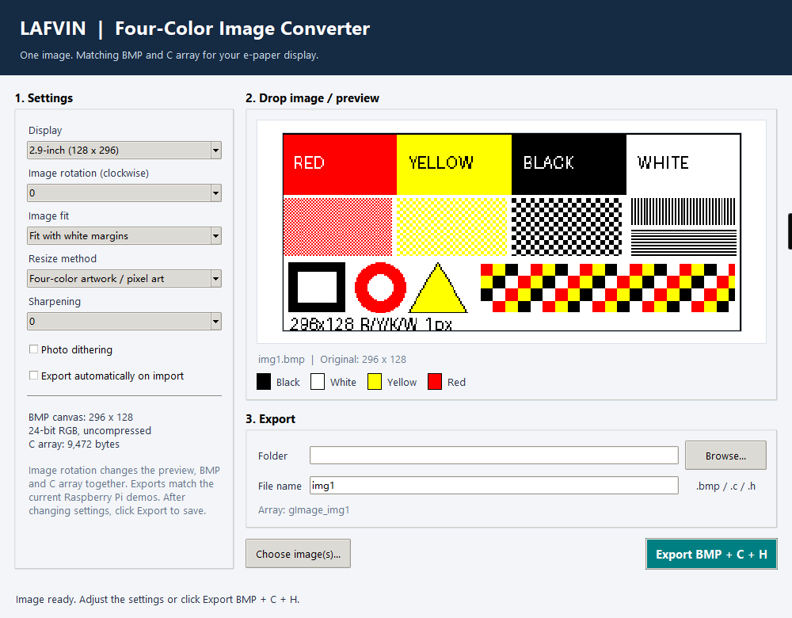

.. _image_processing:

Image Preparation
=================

Use **LAFVIN Four-Color Image Converter v1.0** to prepare your own images for
Raspberry Pi, Arduino UNO R4 or ESP32. One export creates a BMP image and the
matching C array, so you can use the same artwork on all three platforms.

Supported Displays
------------------

Version 1.0 supports the following **black, white, yellow and red** e-paper
panels. Select the model that matches your physical display.

.. list-table:: Supported models and exported image sizes
   :header-rows: 1
   :widths: 25 35 40

   * - Display
     - Native panel resolution
     - Exported BMP size (width x height)
   * - 2.9-inch four-color
     - 128 x 296 pixels
     - 296 x 128 pixels
   * - 1.54-inch four-color
     - 200 x 200 pixels
     - 200 x 200 pixels

.. note::

   For this kit, select **2.9-inch (128 x 296)**. Version 1.0 supports only the
   two four-color models listed above. Other sizes and color combinations
   require a compatible converter version and display driver.

Launch the Tool
---------------

Download and extract the `2.9-inch example project
<https://codeload.github.com/lafvintech/LAFVIN-2.9inch-ePaper-HAT/zip/refs/heads/main>`_.
If you already have the project, open its **Tools** folder.

On **64-bit Windows**, extract the following package:

.. code-block:: text

   Tools/LAFVIN-Image-Converter-1.0.0-win64.zip

Open the extracted folder and double-click **LAFVIN-Image-Converter.exe**.
If you extracted the full project, you can also launch the EXE directly from
**Tools/LAFVIN-Image-Converter-win64/**.
The EXE includes Python, the image-processing library and the drag-and-drop
component. No Python or library installation is required. The package filename
uses **1.0.0** for this **v1.0** release.

   The converter interface. Automatic export is turned off in this example
   so the image can be reviewed before saving.

Prepare Your Source Image
-------------------------

The tool accepts **PNG, JPEG, BMP, GIF, TIFF and WebP** images. It can resize
an image to the selected display, so the input does not have to match the
screen resolution. For the 2.9-inch example, designing a landscape image at
**296 x 128 pixels** helps you control the final layout.

For text, logos and diagrams, use clear shapes and high contrast. If you have
already prepared four-color artwork, use pure black, white, yellow and red.
PNG is useful for keeping small text and sharp edges clear.

Ordinary photos can also be converted. Colors outside the panel's palette
are mapped to the four available colors. Transparent areas become white,
and animated images use their first frame. Check the preview before exporting;
the physical display's colors may differ from the computer preview.

Convert and Export
------------------

1. Under **Display**, select **2.9-inch (128 x 296)** for this kit.
2. Set **Image rotation (clockwise)**. Start with **0**, then choose **90**,
   **180** or **270** if you want to turn the artwork.
3. Choose **Image fit** and **Resize method** using the options below. For
   prepared four-color artwork, start with **Fit with white margins**,
   **Four-color artwork / pixel art**, **Sharpening = 0** and **Photo dithering**
   turned off.
4. Leave **Export automatically on import** enabled to export as soon as an
   image is imported. Turn it off if you want to adjust and preview the image
   before saving.
5. Under **Folder**, choose an output directory with **Browse...**, or leave
   it blank to create a **converted** folder beside the source image.
6. Drag the image into the preview area, or click **Choose image(s)...**.
   The tool loads the image and shows the four-color result.
7. To replace the first demo image, set **File name** to **img1**, without an
   extension. Click **Export BMP + C + H** to save. Use **img2** for the second
   demo image.

By default, the file name is taken from the imported image. If you want to
export directly on import with the demo's file names, name your source image
**img1.png** or **img2.png** before dragging it into the tool.

You can import several images at once. With automatic export enabled, each
image is exported under its own source name. The preview shows the last image.
If an output file already exists, the tool asks before replacing it; choose a
different file name or folder to keep the previous result.

.. important::

   Changing a setting updates the preview. It does **not** update files that
   have already been exported. Click **Export BMP + C + H** again to save the
   new result, including any change to the rotation or file name.

Understand the Settings
-----------------------

Image Rotation
^^^^^^^^^^^^^^

**0** keeps the artwork's current orientation. **90**, **180** and **270**
rotate it clockwise before it is fitted to the display canvas. The preview,
BMP and C array all use the same rotated artwork.

The 2.9-inch BMP remains **296 x 128 pixels** at every image rotation. A
quarter-turn changes the source image's aspect ratio, so margins or cropping
may appear depending on **Image fit**. The exported files match the default
demo orientation; you do not need to change the demo's rotation setting.

Image Fit
^^^^^^^^^

.. list-table:: Fitting an image to the screen
   :header-rows: 1
   :widths: 35 65

   * - Option
     - Effect
   * - **Fit with white margins**
     - Keeps the whole image and its aspect ratio. Fills unused space with white.
   * - **Crop to fill**
     - Keeps the aspect ratio and fills the screen. Crops excess content from
       the edges, keeping the center of the image.
   * - **Stretch to fill**
     - Fills the screen without cropping. May distort shapes and text if the
       source aspect ratio differs from the screen.

Resize Method, Sharpening and Dithering
^^^^^^^^^^^^^^^^^^^^^^^^^^^^^^^^^^^^^^^

.. list-table:: Choosing image-processing options
   :header-rows: 1
   :widths: 35 65

   * - Option
     - When to use it
   * - **Four-color artwork / pixel art**
     - Uses nearest-neighbor resizing to keep hard edges. Recommended for
       prepared four-color images, text, logos and pixel art.
   * - **Smooth photo resizing**
     - Uses smooth resampling when resizing ordinary photos. The result is
       then converted to the four-color palette.
   * - **Sharpening**
     - **0** disables sharpening. Higher values strengthen edges and may help
       photos, but can exaggerate noise. Keep it at **0** for prepared artwork.
   * - **Photo dithering**
     - Uses patterns of the available colors to approximate intermediate
       tones. Try it for photos; leave it off for solid-color artwork and text.

Exported Files
--------------

With **File name = img1**, the tool creates:

.. list-table:: Output files
   :header-rows: 1
   :widths: 25 75

   * - File
     - Purpose
   * - ``img1.bmp``
     - Uncompressed 24-bit RGB BMP for the Raspberry Pi C and Python examples.
   * - ``img1.c``
     - Native four-color pixel array for the Arduino and ESP32 examples.
   * - ``img1.h``
     - Header declaring the array for use from C or C++ code.

Use the Files in the 2.9-inch Examples
--------------------------------------

Raspberry Pi: C or Python
^^^^^^^^^^^^^^^^^^^^^^^^^

1. Export your images as **img1** and **img2** with the **2.9-inch** model selected.
2. Copy the BMP files to the corresponding folder in the project on your
   Raspberry Pi, replacing the demo images:

   * C: ``RPI/c/pic/``
   * Python: ``RPI/python/pic/``

3. Keep both **img1.bmp** and **img2.bmp** in that folder. If you are replacing
   only one image, keep the other original demo image.
4. Run the example again using :ref:`raspberrypi_c` or :ref:`raspberrypi_python`.
   Replacing the BMP files does not require recompiling the C example.

.. note::

   The C and Python examples have separate **pic** folders. Copy the new BMP
   into both folders if you want both examples to show the same image. Keep
   the other files in each folder, including the Python demo's font file.

Arduino UNO R4 or ESP32
^^^^^^^^^^^^^^^^^^^^^^^

1. Export your images as **img1** and **img2** with the **2.9-inch** model selected.
2. Copy the generated C and H files into the folder containing your sketch:

   * Arduino UNO R4: ``Arduino/EPD290_4C/``
   * ESP32: ``ESP32/EPD290_4C/``

3. Replace the existing image C files. Keep only one C file defining each
   image array in the sketch folder; move backup copies outside that folder.
4. Keep **ImageData.h**. The names **img1** and **img2** generate the symbols
   **gImage_img1** and **gImage_img2**, which the existing sketch already uses.
   No change to its image-display calls is required.
5. Compile and upload **EPD290_4C.ino** again, following :ref:`arduino` or the
   :doc:`ESP32 guide </Tutorial/3.esp32>`.

The generated arrays are ready for the examples' **EPD_Display()** calls.
No additional image-array conversion is needed. For a custom file name,
include its generated header and update the image-display call to use the
array name shown in the converter.

Troubleshooting
---------------

**The preview rotates, but the example still shows the old orientation.**

Export again after changing **Image rotation**, then replace the correct BMP
or C file. For Arduino or ESP32, compile and upload the sketch again.

**The Python example reports an unexpected image size.**

Select **2.9-inch (128 x 296)** and export again. The default 2.9-inch demo
expects a **296 x 128** image. Run the Python demo with its default rotation.

**The BMP works in the C example, but Python cannot identify it.**

Make sure **RPI/python/pic/** contains the same newly exported BMP as
**RPI/c/pic/**. Export again if necessary. Renaming a PNG or JPEG file to
**.bmp** does not convert its format.

**The Arduino IDE reports a duplicate image-array definition.**

Remove duplicate image C files from the sketch folder, leaving one definition
of each array. Keep backup files outside the sketch folder, then compile again.

**Drag-and-drop is unavailable.**

Use **Choose image(s)...** to select the file. If needed, extract the
Windows package again and launch its EXE; it includes the drag-and-drop
component.
